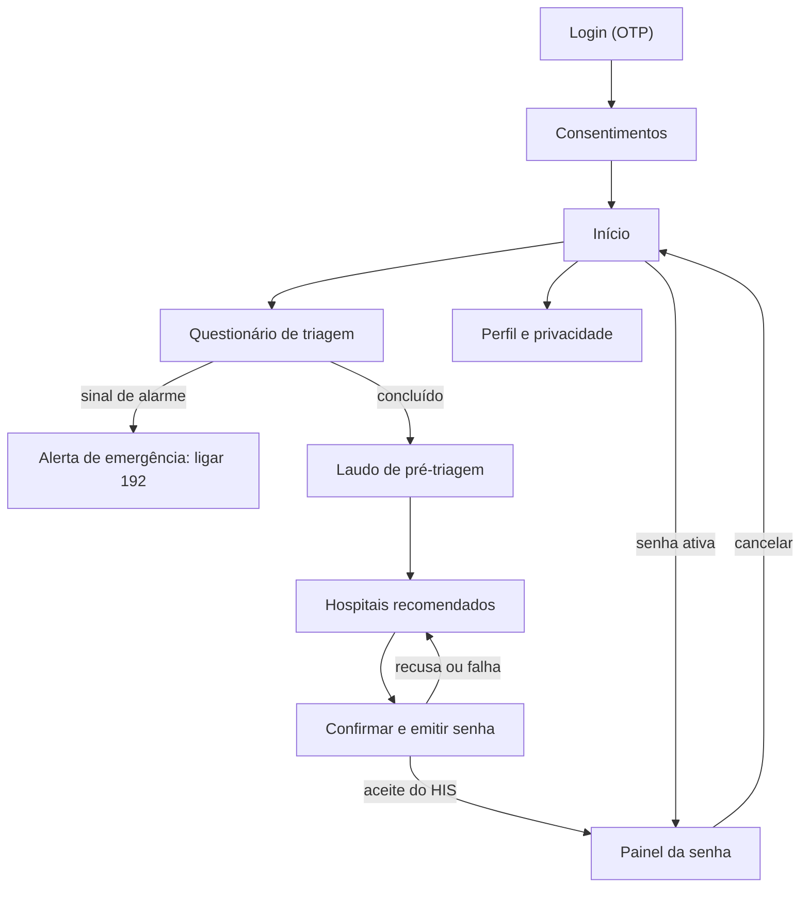
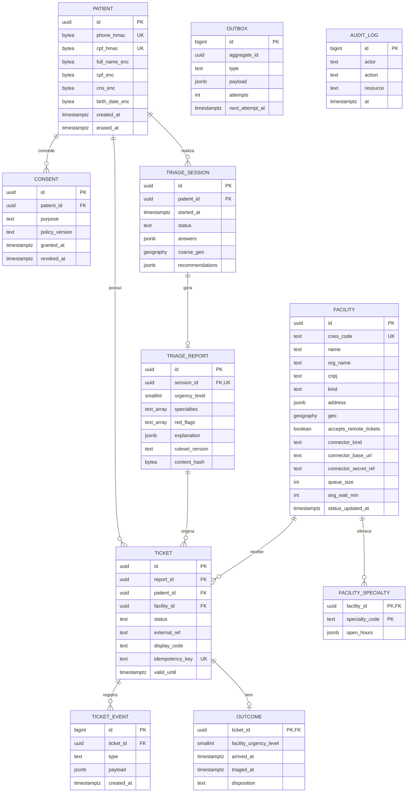

# RFC: BRVital (MDP) — pré-triagem e roteamento interinstitucional de pacientes

*Rascunho para discussão · 10 de novembro de 2026 · baseado no Projeto de Pesquisa para Inovação (FAPESP, Fase 2)*

| Field | Value |
| --- | --- |
| RFC | BRVital — pré-triagem por protocolo clínico, recomendação de hospitais e emissão remota de senha |
| Owner | Equipe fundadora BRVital |
| Status | proposed |
| Version | 0.2.0 (MDP) |

## Foreword

Este documento é dirigido a quem precisa decidir se e como o BRVital será construído: os sócios-fundadores, o Arquiteto de Software Sênior e o Cientista de Dados Clínico (ainda a contratar), a consultoria regulatória e os hospitais piloto.

**Proposta:** construir um aplicativo gratuito que faz a pré-triagem de sintomas com um motor ancorado em protocolo clínico, recomenda hospitais próximos com a especialidade adequada e emite uma senha que entra na fila real do hospital escolhido, por meio de integração padronizada (HL7 FHIR).

**Escopo desta versão (MDP):** a versão 0.2.0 reduz a proposta ao Minimum Deployment Product, o menor produto que pode ser implantado de verdade em um hospital piloto e emitir uma senha real na fila dele. Os principais cortes: urgência definida só por regras do protocolo (sem ML), um único serviço em vez de três, o banco de dados como fila (sem SQS nem Redis) e um hospital em produção. O que saiu está no Apêndice D, com o gatilho para entrar.

O texto apresenta o problema e o estado atual, depois os requisitos (metas mensuráveis, histórias de usuário e critérios de pronto) e, por fim, uma implementação opinativa: stack, esquema do banco de dados e integrações externas. As decisões que mais precisam de objeção estão listadas em *Questões em aberto*, no Apêndice.

## Motivation

O paciente costuma descobrir que foi ao lugar errado só depois de se deslocar e esperar. A literatura indica que cerca de 12% das idas ao pronto-socorro poderiam ser mais bem manejadas em outro ponto de atenção (Wallace et al., 2022) e que usuários frequentes chegam a responder por 31% dos atendimentos de emergência (Acosta; Lima, 2015). O custo é fila, risco clínico e gasto assistencial evitável. Ainda não temos uma estimativa em R$ por visita evitável; obtê-la faz parte do piloto.

A causa imediata é de roteamento, não de falta absoluta de oferta: a classificação de risco acontece dentro da unidade e os sistemas hospitalares (HIS) não conversam entre si. As soluções existentes ou triam sem operar a fila, ou operam a fila sem inteligência clínica, ou ficam presas à rede de um único contratante. Fechar esse ciclo entre instituições independentes é o que propomos.

## Background

- **Triagem tardia.** O Sistema de Triagem de Manchester (no Brasil desde 2008) prioriza bem a ordem de atendimento, mas só atua dentro da unidade, depois do deslocamento.
- **Verificadores de sintomas têm acurácia heterogênea.** A revisão do Imperial College (48 ferramentas) encontrou acurácia diagnóstica de 19% a 36% e de triagem de 48,8% a 90,1%. Em comparação recente, aplicativos ficaram entre 11,5% e 90,0%, LLMs entre 57,8% e 76,0% e leigos entre 47,3% e 62,4% (Kopka et al., 2025). O ganho depende do protocolo clínico embarcado, não de IA generativa genérica.
- **Roteamento existe, mas em silos.** Clearstep roteia dentro da rede de um contratante; Einstein Conecta e e-saúdeSP ficam restritos a uma instituição ou rede municipal; InQuicker e Healthgrades reservam horário sem triagem algorítmica.
- **HIS heterogêneos.** Cada hospital tem seu sistema, com graus muito diferentes de suporte a FHIR. Esta é a maior incerteza técnica do projeto (Incerteza 3 do plano de pesquisa).
- **Regulação.** Dados de saúde são dados pessoais sensíveis (LGPD, art. 11) e o software pode se enquadrar como SaMD (RDC nº 657/2022; classe de risco pela RDC nº 751/2022, a confirmar).
- **Propriedade intelectual.** O campo está ocupado, mas não bloqueado: as anterioridades mais próximas (US9171342B2, US11295854B1) são patentes americanas sem equivalente nacional identificado e não cobrem laudo por IA com escrita na fila real. A busca no INPI e o parecer de liberdade de operação seguem pendentes.

## Requirements

**Solução em uma frase:** uma camada neutra que transforma sintomas relatados em um laudo de pré-triagem versionado, cruza o laudo com a capacidade real de hospitais públicos, filantrópicos e privados, e escreve a senha diretamente no HIS da unidade escolhida.

**Impacto esperado:** o paciente evita deslocamentos inadequados e espera menos; o hospital recebe o paciente já pré-classificado e redistribui demanda; secretarias e operadoras passam a enxergar e reduzir direcionamentos incorretos.

### Definição do MDP

O MDP está pronto quando um paciente adulto, em um hospital piloto real, relata sintomas, recebe um laudo por regras, escolhe a unidade e tem uma senha que aparece na fila do HIS. Para isso entram:

- App móvel com 10 telas (login, consentimentos, questionário, laudo, hospitais, senha, perfil) e um painel web de uma tela para o triador.
- Motor de pré-triagem por regras do protocolo clínico, com sinais de alarme que levam ao 192.
- Um hospital em produção (até 3 se o acordo permitir), cadastrado e configurado pela equipe.
- Um único serviço de backend, com banco PostgreSQL e integração FHIR com o HIS.
- Conformidade mínima para operar: consentimentos separados, RIPD, encarregado (DPO), trilha de auditoria e enquadramento SaMD concluído antes de escrever na fila real.

### Metas mensuráveis

> Os números abaixo são propostas iniciais. Devem ser ratificados pelo Cientista de Dados e por um responsável clínico antes da versão 1.0 desta RFC.

| # | Meta | Como medir | Quando |
| --- | --- | --- | --- |
| M1 | Sensibilidade ≥ 98% para urgência alta (laranja/vermelho) e zero subtriagens de 2 ou mais níveis nos casos críticos | Casos de teste das regras (sintéticos, revisados por clínico) | T5 |
| M2 | Concordância (kappa ponderado) ≥ 0,70 entre o laudo e a classificação do enfermeiro triador | Piloto: laudo × classificação real (`ops.outcome`) | T7 |
| M3 | Emissão de senha com p95 ≤ 5 s do toque ao aceite do HIS e ≥ 95% de sucesso | Métricas do worker do gateway | T7 |
| M4 | Tempo porta→triagem de quem usa a senha, comparado com a mediana histórica da unidade; meta-alvo de redução ≥ 20%, apenas indicativa com 1 hospital | Piloto | T7 |
| M5 | 1 hospital com escrita real na fila | Contagem | T7 |
| M6 | 100% dos laudos e senhas com versão das regras, hash e trilha de auditoria | Auditoria | T7 |

### Fora de escopo

- Diagnóstico, prescrição ou teleconsulta. O laudo é uma pré-triagem e a classificação do hospital sempre prevalece.
- ML e LLM. No MDP a urgência vem só das regras do protocolo; o ML fica para o Pós-MDP, quando houver desfechos reais em `ops.outcome`.
- Perfil de saúde salvo, histórico de triagens, mapa embutido, WhatsApp e login gov.br.
- Painel de capacidade, relatório de impacto, conexão self-service e carga do CNES; mais de 3 hospitais; HL7 v2 (salvo se o HIS do piloto exigir).
- Despacho de ambulância, agendamento eletivo, pagamentos, TISS, escrita na RNDS, pediatria e cobertura fora de São Paulo.

### Histórias de usuário e critérios de aceite

**Épico A — Paciente**

**US-01 · Acesso e consentimento.** Como paciente, quero entrar com meu celular e controlar o que é compartilhado, para usar o app com segurança.

- Dado um número válido, quando confirmo o código OTP, então a conta é criada ou retomada.
- Os consentimentos de triagem e de compartilhamento com o hospital são pedidos separadamente, em linguagem clara; recusar o segundo não impede a pré-triagem.
- Posso revogar qualquer consentimento nas configurações.

**US-02 · Relato de sintomas.** Como paciente com dor ou desconforto, quero relatar sintomas em passos guiados, para receber uma orientação rápida.

- Fluxo por queixa principal e perguntas objetivas, uma por tela, com voltar e progresso visível.
- A sessão é retomada após perda de conexão.
- Telas com contraste AA, fonte ampliável e compatíveis com leitor de tela.

**US-03 · Alerta de emergência.** Como paciente com sinais de gravidade, quero ser avisado na hora para ligar 192, para não perder tempo.

- Ao marcar um sinal de alarme, o fluxo para e mostra a tela de emergência com botão de ligação ao 192.
- Nenhuma senha é emitida nem recomendação exibida nesse caso.
- 100% dos sinais de alarme do protocolo acionam a tela (teste automatizado).

**US-04 · Laudo de pré-triagem.** Como paciente, quero ver um resumo do meu quadro e do nível de urgência, para entender por que fui direcionado.

- O nível aparece em cor e em texto, com as especialidades sugeridas e o aviso de que não é diagnóstico.
- O laudo é gravado de forma imutável, com versão do motor e hash.
- Os textos foram revisados pelo responsável clínico.

**US-05 · Recomendação de hospitais.** Como paciente, quero ver hospitais próximos com a especialidade certa, tempo de chegada e espera estimada, para escolher bem.

- Só aparecem unidades com especialidade compatível com o laudo e abertas no horário previsto de chegada.
- Cada item mostra tempo de deslocamento, distância e espera estimada com a hora da última atualização; sem dado confiável, a unidade aparece sem espera.
- Se nego a localização, posso informar bairro ou CEP.

**US-06 · Emissão da senha.** Como paciente, quero escolher uma unidade e receber a senha, para entrar na fila real ao chegar.

- Ao confirmar, em até 5 s (p95) vejo a senha ou o motivo da falha com a próxima unidade sugerida.
- A senha aparece na fila do HIS com a prioridade do laudo, e o código no app é o mesmo da unidade.
- Tocar duas vezes não gera senha duplicada; só existe uma senha ativa por paciente.
- Apenas os dados consentidos e necessários são enviados ao hospital.

**US-07 · Acompanhar e cancelar.** Como paciente com senha ativa, quero ver o status e cancelar se desistir, para não ocupar vaga indevidamente.

- O status é atualizado por push; o cancelamento é propagado ao HIS.
- A senha expira automaticamente ao fim da validade.

**Épico B — Hospital**

**US-08 · Conexão do HIS.** Como TI do hospital, quero conectar meu sistema ao BRVital por padrão aberto, para receber pacientes pré-classificados sem trocar de sistema.

- A equipe BRVital configura o conector do hospital (sem autoatendimento no MDP).
- Antes de ir para produção, o conector passa em uma suíte de conformidade em homologação (criar com idempotência, cancelar, ler fila).
- Credenciais por unidade, rotacionáveis, com mTLS; se o HIS falha, a unidade deixa de ser recomendada em até 1 min.

**US-09 · Triagem na chegada.** Como enfermeiro triador, quero ver o laudo de quem chegou com senha e registrar a classificação final, para manter a autonomia clínica e alimentar a validação do modelo.

- O laudo fica visível no painel web do BRVital (e no HIS, se o conector suportar).
- A classificação do hospital prevalece e é gravada como desfecho (`ops.outcome`).

**Épico C — Conformidade, dados e gestão**

**US-11 · Auditoria.** Como responsável de conformidade, quero reconstruir qualquer laudo e senha, para atender LGPD e ANVISA.

- Dado um ticket, vejo respostas, versões das regras, hash, eventos e acessos.
- A trilha é somente de anexação (append-only); o encadeamento por hash fica para o Pós-MDP.

**US-12 · Direitos do titular.** Como paciente, quero exportar ou excluir meus dados, para exercer meus direitos na LGPD.

- O pedido é feito no app (Perfil e privacidade) ou por e-mail ao encarregado, confirmado na hora e respondido por completo em até 15 dias.
- A equipe executa a exportação ou a exclusão por rotina documentada; a exclusão anonimiza os dados pessoais e preserva só o mínimo exigido por lei.

### Critérios de pronto (Definition of Done) — valem para toda história

- Pull request com pelo menos 1 aprovação, CI verde e testes escritos antes do código (TDD) nos módulos de domínio (triagem, ticket, consentimento), com cobertura ≥ 80% neles.
- Testes de integração contra um servidor FHIR de homologação (HAPI) para tudo que toca o gateway.
- Sem vulnerabilidade crítica em SAST e dependências; segredos somente no Secrets Manager; logs sem dados pessoais; erro no fluxo novo chega ao Sentry com alerta.
- OpenAPI atualizada; ADR registrado quando houver decisão de arquitetura.
- Telas novas ou alteradas atendem WCAG 2.1 AA.
- Mudança nas regras clínicas: versão registrada, casos de teste atualizados e aprovação do responsável clínico.
- Publicado em staging atrás de feature flag, com smoke test e demonstração na review da sprint.

## Implementation

### Visão geral

```
App móvel (React Native)
        │ HTTPS + JWT
        ▼
 core-api (NestJS, um único serviço)
   ├─ módulos: sessões · regras de triagem · rede de hospitais · tickets
   ├─ worker do gateway (lê ops.outbox) ──► HIS do hospital piloto (FHIR)
   └─ PostgreSQL + PostGIS (dados, outbox e cache)
```

O plano de pesquisa fala em microsserviços. Para o MDP propomos **um único serviço**, o `core-api`, organizado em módulos (sessões, regras de triagem, rede de hospitais e tickets), com o worker do gateway no mesmo código e rodando como processo separado. As fronteiras entre módulos já seguem as incertezas do projeto, então separar um `hospital-gateway` e, mais tarde, um `triage-engine` de ML será só uma mudança de deploy.

### Stack

| Camada | Escolha | Por quê | Descartado no MDP |
| --- | --- | --- | --- |
| App móvel | React Native + Expo, TypeScript | Mesma linguagem do backend, com tipos e validação compartilhados | Flutter: introduz Dart sem ganho decisivo para telas de formulário |
| Backend | Node.js + NestJS, monolito modular, OpenAPI; regras de triagem em YAML versionado | Um repositório e um deploy para uma equipe pequena | Microsserviços e Python/FastAPI: só quando houver ML |
| Gateway | Worker no mesmo código; tipos `@medplum/fhirtypes`; validador HAPI no CI | Reaproveita o modelo de domínio | — |
| Banco | PostgreSQL 16 + PostGIS (RDS) | Transacional e geoespacial no mesmo lugar; também faz o papel de fila (outbox) | SQS, Redis e Kafka: sem necessidade nessa escala |
| Infra | AWS sa-east-1, ECS Fargate, Terraform, GitHub Actions | Dados no Brasil simplificam a LGPD | Kubernetes: complexidade desnecessária |
| Autenticação | OTP por SMS (paciente); Cognito (painel); mTLS com o HIS | Fricção mínima para quem está com dor | gov.br e WhatsApp: Pós-MDP |
| Observabilidade | Sentry + CloudWatch | Suficiente para 1 hospital | OpenTelemetry e Grafana: Pós-MDP |

A linha de nuvem do orçamento (R$ 7.500/mês) comporta esse desenho no piloto; a estimativa precisa ser validada, e o item mais volátil é o custo da API de rotas (mitigado por cache).

### Motor de pré-triagem (módulo de regras)

1. **Entrada estruturada.** Árvore de decisão por queixa principal, com discriminadores objetivos. Texto livre fica fora do caminho crítico.
2. **Regras do protocolo.** Regras determinísticas definem o nível de urgência, as especialidades e os sinais de alarme. Ficam em arquivos YAML versionados, revisáveis por um clínico e cobertos por casos de teste.
3. **Regra de segurança.** Resposta ausente ou duvidosa em um discriminador crítico sobe um nível; sinal de alarme leva à tela de emergência (192).
4. **Saída.** Laudo imutável com nível, especialidades, sinais de alarme, explicação (quais discriminadores pesaram), versão das regras e hash SHA-256.
5. **Dados para o futuro.** Toda senha gera um registro em `ops.outcome` com a classificação real do hospital. É a base do ML do Pós-MDP; o MDP não treina modelo.

### Interface do aplicativo (telas)

O app precisa de 10 telas, organizadas em torno de um fluxo principal curto: relatar sintomas, ver o laudo, escolher o hospital e acompanhar a senha. O acesso ao 192 fica sempre visível.



**Princípios de interface**

- Uma pergunta por tela, botões grandes e linguagem leiga, pensando em quem está com dor ou sob estresse.
- Contraste e fonte ampliável conforme WCAG 2.1 AA; o nível de urgência sempre em cor *e* texto.
- Progresso salvo a cada resposta, para retomar após queda de conexão ou ligação.

**Telas do app**

| # | Tela | O que mostra e o que o usuário faz | Histórias |
| --- | --- | --- | --- |
| S-01 | Login | Explica o app em uma frase, pede o celular e confirma o código OTP | US-01 |
| S-02 | Consentimentos | Dois aceites separados (triagem; compartilhamento com o hospital), com texto claro e aviso de que não é diagnóstico | US-01 |
| S-03 | Início | Botão principal “Preciso de atendimento”, card da senha ativa (se houver) e botão fixo do 192 | US-02, US-07 |
| S-04 | Questionário de triagem | Sexo, comorbidades e queixa principal, depois perguntas objetivas, uma por tela, com voltar e barra de progresso (a idade vem do cadastro) | US-02 |
| S-05 | Alerta de emergência | Interrompe o fluxo, orienta a ligar 192 e mostra o endereço aproximado; sem senha nem recomendação | US-03 |
| S-06 | Laudo de pré-triagem | Nível de urgência (cor e texto), especialidades sugeridas, motivos e aviso de que o hospital reavalia | US-04 |
| S-07 | Hospitais recomendados | Lista com endereço, especialidades, tempo de deslocamento, distância e espera estimada (com hora da atualização) | US-05 |
| S-08 | Confirmar e emitir senha | Resumo do que será compartilhado com o hospital, confirmação e estado de envio (até 5 s); em falha, sugere a próxima unidade | US-06 |
| S-09 | Painel da senha | Código da senha em destaque, status, validade, hospital, botão “Navegar” (abre o app de mapas), laudo resumido e “Cancelar senha” | US-06, US-07 |
| S-10 | Perfil e privacidade | Dados pessoais (nome, CPF ou CNS, nascimento), revogar consentimentos, pedir exportação ou exclusão dos dados e sair | US-01, US-12 |

Telas de estado (não numeradas, mas parte do escopo): localização negada (pede bairro ou CEP), sem conexão (retoma de onde parou), falha na emissão e senha expirada.

O perfil de saúde salvo (`clinical.health_profile`) fica para o Pós-MDP: no MDP, a idade vem do cadastro e sexo e comorbidades são perguntados em cada sessão e gravados em `answers`.

**Painel web (triador do hospital)**

No MDP o painel web tem uma única tela, para o triador do hospital piloto (React, login via Cognito). O cadastro e a configuração dos hospitais são feitos pela equipe por script, sem telas.

| # | Tela | Quem usa e para quê | Histórias |
| --- | --- | --- | --- |
| W-01 | Fila de pré-triagens | O triador vê quem chegou com senha, abre o laudo e registra a classificação final | US-09 |

### Esquema do banco de dados

PostgreSQL com quatro schemas: `identity` (único lugar com dados pessoais, cifrados por coluna), `clinical`, `network` e `ops`. IDs são UUID v7; datas em `timestamptz`.

O diagrama mostra as 11 tabelas e seus relacionamentos; o SQL completo vem logo abaixo.



O paciente (`identity`) e o hospital (`network`) são os dois pontos de partida: a sessão de triagem (`clinical`) gera o laudo imutável e o ticket (`ops`) liga laudo, paciente e hospital. No MDP, organização e conector foram fundidos em `FACILITY` e as recomendações viram um JSON na sessão. `OUTBOX` e `AUDIT_LOG` ficam sem chave estrangeira de propósito, porque são trilhas independentes das entidades.

```sql
CREATE EXTENSION IF NOT EXISTS postgis;
CREATE SCHEMA identity; CREATE SCHEMA clinical; CREATE SCHEMA network; CREATE SCHEMA ops;

-- identity: PII cifrada com envelope encryption (KMS); HMAC permite busca sem expor o valor
CREATE TABLE identity.patient (
  id uuid PRIMARY KEY,
  phone_hmac bytea UNIQUE NOT NULL,
  full_name_enc bytea, cpf_enc bytea, cpf_hmac bytea UNIQUE, cns_enc bytea, birth_date_enc bytea,
  created_at timestamptz NOT NULL DEFAULT now(),
  erased_at timestamptz                     -- anonimização (LGPD art. 18)
);
CREATE TABLE identity.consent (
  id uuid PRIMARY KEY,
  patient_id uuid NOT NULL REFERENCES identity.patient,
  purpose text NOT NULL CHECK (purpose IN ('triage','share_with_facility','research')),
  policy_version text NOT NULL,
  granted_at timestamptz NOT NULL, revoked_at timestamptz
);

-- network: hospital piloto (organização e conector na mesma linha no MDP)
CREATE TABLE network.facility (
  id uuid PRIMARY KEY, cnes_code text UNIQUE, name text NOT NULL,
  org_name text NOT NULL, cnpj text NOT NULL,
  kind text NOT NULL CHECK (kind IN ('public','philanthropic','private')),
  address jsonb NOT NULL, geo geography(Point,4326) NOT NULL,
  accepts_remote_tickets boolean NOT NULL DEFAULT false,
  connector_kind text NOT NULL CHECK (connector_kind IN ('fhir_r4','hl7v2')),
  connector_base_url text NOT NULL, connector_secret_ref text NOT NULL,
  queue_size int, avg_wait_min int, status_updated_at timestamptz   -- último estado lido do HIS
);
CREATE INDEX ON network.facility USING gist (geo);
CREATE TABLE network.facility_specialty (
  facility_id uuid REFERENCES network.facility, specialty_code text,
  open_hours jsonb NOT NULL,
  PRIMARY KEY (facility_id, specialty_code)
);

-- clinical: sessão e laudo (imutável)
CREATE TABLE clinical.triage_session (
  id uuid PRIMARY KEY, patient_id uuid NOT NULL REFERENCES identity.patient,
  started_at timestamptz NOT NULL DEFAULT now(), status text NOT NULL,
  answers jsonb NOT NULL,                   -- inclui sexo e comorbidades informados na sessão
  coarse_geo geography(Point,4326),         -- localização arredondada
  recommendations jsonb                     -- unidades exibidas, com tempo e espera no momento
);
CREATE TABLE clinical.triage_report (       -- sem UPDATE/DELETE (trigger + permissões)
  id uuid PRIMARY KEY,
  session_id uuid UNIQUE NOT NULL REFERENCES clinical.triage_session,
  urgency_level smallint NOT NULL CHECK (urgency_level BETWEEN 1 AND 5),
  specialties text[] NOT NULL, red_flags text[] NOT NULL DEFAULT '{}',
  explanation jsonb NOT NULL,
  ruleset_version text NOT NULL,
  content_hash bytea NOT NULL, created_at timestamptz NOT NULL DEFAULT now()
);

-- ops: senha, eventos, outbox, desfecho e auditoria
CREATE TABLE ops.ticket (
  id uuid PRIMARY KEY,
  report_id uuid NOT NULL REFERENCES clinical.triage_report,
  patient_id uuid NOT NULL REFERENCES identity.patient,
  facility_id uuid NOT NULL REFERENCES network.facility,
  status text NOT NULL CHECK (status IN ('requested','sent','active','rejected','failed',
                                         'cancelled','expired','attended','no_show')),
  external_ref text, display_code text, priority smallint NOT NULL,
  idempotency_key text UNIQUE NOT NULL,
  issued_at timestamptz, valid_until timestamptz
);
CREATE UNIQUE INDEX one_active_ticket ON ops.ticket (patient_id)
  WHERE status IN ('requested','sent','active');
CREATE TABLE ops.ticket_event (             -- append-only
  id bigserial PRIMARY KEY, ticket_id uuid NOT NULL REFERENCES ops.ticket,
  type text NOT NULL, payload jsonb NOT NULL, created_at timestamptz NOT NULL DEFAULT now()
);
CREATE TABLE ops.outbox (
  id bigserial PRIMARY KEY, aggregate_id uuid NOT NULL, type text NOT NULL,
  payload jsonb NOT NULL, attempts int NOT NULL DEFAULT 0,
  next_attempt_at timestamptz NOT NULL DEFAULT now(), published_at timestamptz
);
CREATE TABLE ops.outcome (                  -- base do ML do Pós-MDP e da meta M2
  ticket_id uuid PRIMARY KEY REFERENCES ops.ticket,
  facility_urgency_level smallint, arrived_at timestamptz,
  triaged_at timestamptz, disposition text
);
CREATE TABLE ops.audit_log (                -- append-only (sem UPDATE/DELETE por permissão)
  id bigserial PRIMARY KEY, actor text NOT NULL, action text NOT NULL, resource text NOT NULL,
  at timestamptz NOT NULL DEFAULT now()
);
```

**Decisões do esquema**

- Dados pessoais ficam isolados em `identity`; as demais tabelas só referenciam `patient_id`, o que facilita a anonimização.
- O laudo é imutável e o ticket aponta para ele; qualquer reprocessamento gera um novo laudo.
- A idempotência vive no banco (`idempotency_key` único e índice parcial de uma senha ativa por paciente), não só na aplicação.
- O painel do hospital filtra por `facility_id` na aplicação; row-level security entra com o segundo hospital.
- Retenção proposta: sessões que não geraram senha são anonimizadas em 90 dias; os prazos finais saem do RIPD.
- Simplificações do MDP: organização e conector fundidos em `facility`; a fila lida do HIS guarda só o último estado (sem série temporal); sem tabela de recomendações.

### Integrações externas

| Integração | Uso | Decisão | Fase |
| --- | --- | --- | --- |
| **HIS do hospital piloto** | Escrever a senha na fila e ler fila/capacidade | Adaptador FHIR R4 no `core-api`. Adaptador HL7 v2 (ADT via MLLP) só se o HIS do piloto não suportar FHIR. Sem RPA/scraping | T5–T7 |
| **Google Maps Platform (Routes)** | Tempo de deslocamento com trânsito | PostGIS filtra por raio; só os 10 melhores candidatos vão à API de matriz de rotas; cache em memória de 3 min; sem a API, a lista usa só a distância | T5 |
| **OTP por SMS** | Login do paciente | Provedor atrás de um adaptador (Zenvia ou Twilio) | T3 |
| **Push (FCM/APNs)** | Status da senha | Notificações simples; WhatsApp fica fora | T4 |

**Mapeamento FHIR da emissão da senha.** O gateway envia um *transaction Bundle* para atomicidade:

- `Patient`: mínimo necessário (nome, CPF/CNS, nascimento), só com o consentimento `share_with_facility`.
- `Encounter`: classe de emergência, `status = planned` (o hospital muda para `arrived` na chegada), com o hospital como `serviceProvider`. O `identifier` carrega a chave de idempotência, usada em criação condicional (`If-None-Exist`).
- `Observation`: nível de urgência da pré-triagem; `DocumentReference`: laudo em PDF com o hash.
- A resposta do HIS devolve o id do `Encounter` e o código da senha, gravados em `external_ref` e `display_code`.
- Para HIS sem FHIR, o adaptador traduz o Bundle para HL7 v2 (pré-admissão, ADT^A05) ou para a API proprietária, mas só se o piloto exigir.

Todo conector passa por uma suíte de conformidade em homologação antes de receber `accepts_remote_tickets = true`.

### API própria e ciclo de vida da senha

```
POST /v1/triage-sessions                          -> 201 { sessionId, firstQuestion }
POST /v1/triage-sessions/{id}/answers             -> 200 { nextQuestion | outcome: EMERGENCY | REPORT_READY }
GET  /v1/triage-sessions/{id}/report              -> 200 TriageReport
GET  /v1/triage-sessions/{id}/recommendations?lat=&lng=  -> 200 Recommendation[]
POST /v1/tickets   (header Idempotency-Key obrigatório)  body { reportId, facilityId } -> 202 { ticketId, status: 'requested' }
GET  /v1/tickets/{id}                             -> 200 Ticket
POST /v1/tickets/{id}/cancel                      -> 200 Ticket
```

**Estados da senha:** `requested → sent → active`; de `sent` pode ir a `rejected` ou `failed`; de `active` a `attended`, `no_show`, `expired` ou `cancelled`.

**Fluxo de emissão**

1. O app chama `POST /v1/tickets`; o `core-api` grava o ticket e uma linha em `ops.outbox` na mesma transação.
2. O worker do gateway lê `ops.outbox` (com `SELECT ... FOR UPDATE SKIP LOCKED`), monta o Bundle e chama o HIS.
3. Com o aceite, grava `external_ref` e `display_code`, o ticket vira `active` e o app recebe push (o app também consulta o status por até 5 s).
4. Se o HIS recusar ou não responder após as tentativas, o ticket vira `rejected` ou `failed` e o app oferece a próxima unidade da lista. Nunca há falha silenciosa.
5. `valid_until` = tempo estimado de chegada + janela (padrão de 30 min, configurável por hospital).

### Segurança e conformidade

- TLS em todo tráfego, cifra em repouso e por coluna para dados pessoais, mTLS com hospitais e rotação de credenciais.
- Minimização: nada vai ao HIS antes de o paciente escolher a unidade e ter consentido o compartilhamento.
- RIPD e encarregado (DPO) definidos antes do piloto; logs sem dados pessoais.
- Ciclo de vida de SaMD (gestão de risco, usabilidade e manutenção do software) conduzido com a consultoria regulatória; a lista exata de normas e evidências sai do enquadramento da RDC nº 657/2022.

### Plano de entrega

O MDP cabe no cronograma do plano de pesquisa, com a meta proposta de estar em produção com 1 hospital até o T7, um trimestre antes do piloto de 3 hospitais previsto para o T8. A dependência crítica é o acordo com o hospital e o ambiente de homologação do HIS; sem eles, o cronograma desliza.

| Marco | Entrega | Período |
| --- | --- | --- |
| M0 · Base | Terraform e CI; esquema v0; HAPI como HIS falso; catálogo de discriminadores e primeiras regras com casos de teste | T1–T2 |
| M1 · Alfa | App + `core-api` (OTP, consentimento, questionário, laudo) ponta a ponta contra o HIS falso | T3–T4 |
| M2 · Beta | Recomendação (PostGIS + rotas) e emissão de senha via FHIR no HIS falso; trilha de auditoria; regras validadas (M1) | T5 |
| M3 · Homologação | Conector do hospital piloto em homologação, em modo sombra; painel W-01; RIPD e enquadramento SaMD concluídos | T6 |
| M4 · MDP em produção | 1 hospital com escrita real na fila; medição de M2 a M6 | T7 |
| Depois do MDP | Até 3 hospitais, auditorias finais e itens do Apêndice D | T8 |

## Signoff & Comments

| Name | +1/-1 | Comments |
| --- | --- | --- |
| Arquiteto de Software Sênior (TT-5, a contratar) |  |  |
| Cientista de Dados Clínico (TT-4A, a contratar) |  |  |
| Responsável clínico (médico ou enfermeiro, a definir) |  |  |
| Consultoria regulatória e jurídica (SaMD, LGPD) |  |  |
| João Gabriel Bruni |  |  |
| Marianna Saltarelli |  |  |
| Caio Vinícius Bernardo |  |  |
| Lucas Neves |  |  |
| Willian Farias |  |  |
| Representante de TI do hospital piloto |  |  |

## Appendix

### A. Alternativas consideradas e rejeitadas

- **LLM generativo como motor de triagem.** As evidências citadas (Wallace et al.; Kopka et al.) mostram risco de subtriagem e ganho não replicado por LLM genérico. Poderia entrar apenas para converter texto livre em discriminadores, sempre com confirmação do paciente; não nesta versão.
- **Microsserviços desde o início.** No MDP, nem os três serviços da versão 0.1.0: um monolito modular basta, e a separação fica para quando houver ML.
- **SQS, Redis, Kafka, Kubernetes e Flutter.** Ver tabela de stack.
- **RPA ou acesso direto ao banco de HIS legado.** Frágil, difícil de auditar e de difícil sustentação regulatória.
- **Servidor FHIR próprio (HAPI JPA) como banco principal.** Complexidade alta para o ganho; mantemos o modelo relacional e usamos FHIR na borda.

### B. Questões em aberto

1. **Licenciamento do protocolo.** O uso dos fluxogramas do Manchester no Brasil pode exigir licença (verificar com o grupo detentor no país); alternativa é um protocolo público, como o de classificação de risco do Ministério da Saúde. A decisão bloqueia as regras do MDP.
2. **Classe de risco do SaMD** (RDC nº 751/2022): notificação ou registro na ANVISA, e o impacto no cronograma da escrita real na fila.
3. **HIS do hospital piloto:** qual é, se fala FHIR e se há ambiente de homologação.
4. **Janela de validade da senha** e política de no-show por hospital.
5. **Fonte de fila em tempo real:** push do HIS ou polling, e com que frequência.
6. **Casos de teste das regras:** quem os fornece (sintéticos revisados por clínico) e o que exige acordo e aprovação em comitê de ética para usar dados reais.
7. **Pediatria no MDP?** Exige consentimento do responsável (LGPD, art. 14). Proposta: só adultos.
8. **Papel do Cientista de Dados (TT-4A) no MDP.** Sem ML, o papel passa a ser validar as regras, montar o conjunto de avaliação e preparar o ML do Pós-MDP. Adiar o ML precisa ser confirmado com a equipe e com o plano de pesquisa (Incerteza 1).
9. **Ratificação das metas M1–M6** pelo Cientista de Dados e pelo responsável clínico.

### C. Riscos principais

| Risco | Mitigação |
| --- | --- |
| Hospital sem FHIR ou sem homologação atrasa a integração | Escolher o piloto com FHIR; adaptador HL7 v2 só se necessário; modo sombra |
| Subtriagem de caso grave | Regras revisadas por clínico, subida de um nível na dúvida, sinais de alarme, casos de teste críticos (M1) e classificação do hospital prevalecendo |
| Custo da API de rotas acima do previsto | Pré-filtro PostGIS, cache, limite de 10 candidatos; sem a API, só distância |
| Equipe fundadora ainda em graduação | Supervisão dos bolsistas seniores, revisão obrigatória de PR, ADRs |
| Atraso regulatório (SaMD, INPI) | Consultoria desde o T1; escrita real condicionada ao enquadramento |
| Escopo do MDP crescer | O que não está na Definição do MDP vai para o Apêndice D, com gatilho |

### D. Pós-MDP: o que ficou de fora

| Item | Por que ficou fora | Gatilho para entrar |
| --- | --- | --- |
| ML calibrado sobre as regras e gate de promoção (US-13) | Exige desfechos reais; as regras já cobrem a segurança | Volume de desfechos em `ops.outcome` definido com o Cientista de Dados |
| Perfil de saúde salvo (`clinical.health_profile`) | Só encurta o questionário | Feedback do piloto sobre o tempo de relato |
| Painel de capacidade (US-10) e conexão self-service | A equipe configura de 1 a 3 hospitais | Mais de 3 hospitais |
| Relatório de impacto (US-14) | No piloto, os indicadores saem de consulta direta | Primeiro contrato com secretaria ou operadora |
| Histórico, mapa embutido, WhatsApp e gov.br | Conveniência, não necessidade | Pós-piloto |
| Carga do CNES, HL7 v2 e RNDS | Os hospitais do MDP são cadastrados à mão | Expansão da rede ou HIS sem FHIR |
| SQS, Redis, serviços separados e OpenTelemetry | O banco e um processo bastam para 1 hospital | Carga ou equipe maiores |
| Hash encadeado na auditoria, RLS e série temporal de fila | Controles extras, não requisitos do MDP | Segundo hospital ou exigência da auditoria |
